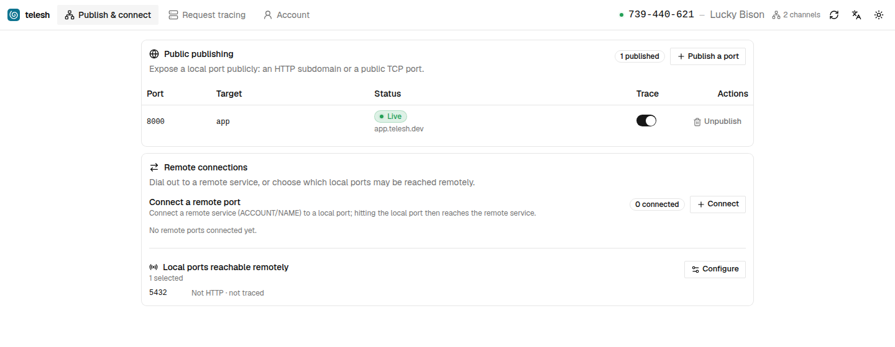
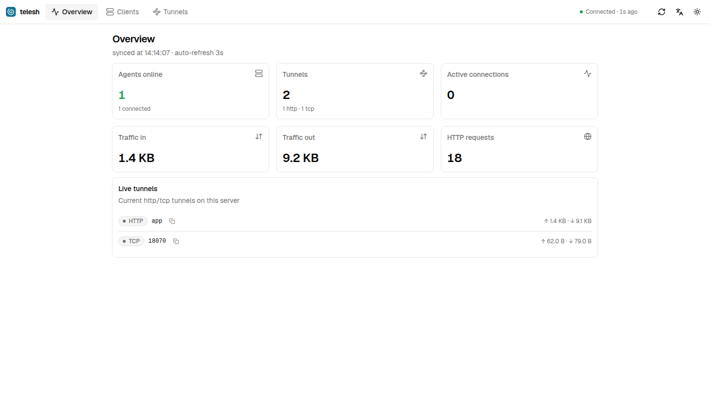

# telesh

**English** · [简体中文](README.zh-CN.md)

**Two desktop apps for self-hosted tunneling: publish local ports to the internet, mirror remote
ports locally.**

telesh ships as two apps you open and click. **telesh agent** runs on the machine that owns the
services: it lists the ports already listening there, publishes them to a public edge, exposes them
peer-to-peer, and mirrors remote services onto local ports. **telesh server** is the host side:
control plane, edge ingress, data plane, an optional embedded relay, and the dashboard you watch
from. Both are tray-resident desktop apps for Linux, Windows, and macOS, and each bundles its own
local dashboard — no Node runtime, no web assets to deploy.



## Features

### 1. telesh agent: publish out, mirror in, from one window

Click **+ Publish a port** and the agent offers the ports already listening on the machine. Pick one
and decide how it should be reachable; the agent keeps the running state converged to what the
window says, so toggles apply immediately and survive restarts.

| Capability | What telesh agent gives you |
| --- | --- |
| Local port discovery | Lists listening TCP ports with their processes, and reverse-maps them from `/proc`; inside a container it sees exactly the container's ports |
| HTTP publishing | A fixed subdomain routed by `Host` to a local port, with per-port request tracing and one-click replay |
| TCP publishing | A public port allocated from the server's range (or a port you pick) for SSH, databases, game servers, or any raw TCP service |
| P2P inbound | [iroh](https://www.iroh.computer/) hole-punched QUIC with automatic encrypted-relay fallback; several services share one endpoint |
| Remote mirroring | Maps `ACCOUNT/NAME` to a local listener, follows directory updates, and rebuilds the data path after a disconnect |
| Publication state | Every entry shows `pending`, `live`, `error`, or `target_gone` (the local port disappeared), instead of failing silently |
| Account view | Signed-in account, public key, control server, data directory, session expiry, and the last error in one place |

The same local port can be published as HTTP, TCP, and P2P at the same time, and several remote
mirrors can stay open — one agent process manages them all.

### 2. telesh server: the host side, with a dashboard of its own

The server app is where the public traffic lands. First launch writes a `server.toml` you can open
from the tray, starts the bundled control server, and shows its dashboard in the window.



| Capability | What telesh server gives you |
| --- | --- |
| One config file | `control_addr`, `ingress_addr`, `data_addr`, TCP port range, public host, data root — all with defaults |
| Edge ingress | HTTP routing by `Host`, raw TCP routing by port, both forwarded over the agent's data connection |
| Data plane | Agent-initiated TCP multiplexed with [yamux](https://github.com/hashicorp/yamux/blob/master/spec.md); the server never dials the agent |
| Embedded relay | Optional in-process iroh relay with manual TLS or ACME / Let's Encrypt and QUIC address discovery |
| Dashboard | Overview (agents, tunnels, traffic, HTTP requests), clients, tunnels, and `/api/metrics/prometheus` for scraping |
| Zero client config | Relay URL and data-plane address are pushed during login; the agent only needs the control address |
| Identity | Ed25519 challenge-response, 9-digit account on first login (TOFU), 12h sessions, opaque access tokens validated online |

### 3. Two apps, one split: control plane and data plane

The public edge never reaches into your machine: the agent dials out, and payload never shares a
connection with control messages. That split is why the control schema can evolve without touching
the forwarding path, and why the agent works from behind NAT without a public IP.

| Plane | Transport | Carries |
| --- | --- | --- |
| Control | WebSocket, JSON | Login, subdomain and TCP port registration, P2P directory, keepalive, metering |
| Data | Agent-initiated TCP with yamux | Stream 1 is signaling (CBOR); every public connection gets its own raw byte stream |
| P2P | iroh QUIC | Hole-punched peer payload; the server only provides the directory and token checks |

```text
public client ──► telesh server edge ──data plane (yamux)──► telesh agent ──► 127.0.0.1:8000
                         ▲
                         │ control (WebSocket / JSON): login, routes, directory, keepalive
                         │
peer ──iroh QUIC (hole punching, relay fallback)──► telesh agent ──► 127.0.0.1:5432
```

HTTP and TCP payload always take the agent-initiated data connection. If the agent is not connected,
the edge answers `503` (or closes the TCP connection) instead of buffering. P2P payload never passes
through the server; only directory lookups and short-lived access-token checks do.

## Download

Installers are published on [GitHub Releases](https://github.com/zeaphoo/telesh/releases). Both apps
bundle the headless binary that embeds their dashboard, so there is nothing else to install.

| App | Linux | Windows | macOS |
| --- | --- | --- | --- |
| **telesh agent** | `telesh-agent-app_<version>_linux_<arch>.deb` (Debian/Ubuntu), `....AppImage` | `telesh-agent-app_<version>_windows_x64-setup.exe` (NSIS), `....msi`, `..._portable.zip` | `telesh-agent-app_<version>_macos_<arch>.dmg` (Intel `x86_64` / Apple Silicon `arm64`) |
| **telesh server** | `telesh-server-app_<version>_linux_<arch>.deb`, `....AppImage` | `telesh-server-app_<version>_windows_x64-setup.exe`, `....msi`, `..._portable.zip` | `telesh-server-app_<version>_macos_<arch>.dmg` |

The same release also ships headless service packages (`deb` / `rpm` with systemd units) and
standalone archives for servers you administer without a desktop; their contents are described in
[`packaging/README.md`](packaging/README.md).

System requirements:

- **Linux**: x86_64 or arm64 with WebKitGTK 4.1 (available on Ubuntu 22.04+, Debian 12+, and
  similar; the deb pulls in its dependencies).
- **Windows**: Windows 10 / 11 (x64) with the WebView2 runtime (normally installed with Edge).
- **macOS**: macOS 11+ on Intel or Apple Silicon, using the system WebKit.
- **Server host**: a machine with a public address for the agent to dial, and the ports you publish
  reachable through its firewall or security group.

## Install

### Linux

deb (recommended; handles dependencies and desktop integration):

```bash
sudo apt install ./telesh-agent-app_<version>_linux_amd64.deb
sudo apt install ./telesh-server-app_<version>_linux_amd64.deb
```

AppImage (no installation):

```bash
chmod +x telesh-agent-app_<version>_linux_amd64.AppImage
./telesh-agent-app_<version>_linux_amd64.AppImage
```

After installing, launch **telesh agent** or **telesh server** from the application menu.

### Windows

- **Installer**: run `..._windows_x64-setup.exe` and follow the wizard. The `.msi` is available for
  managed or silent deployment.
- **Portable**: unzip `..._portable.zip` and keep the app executable together with its
  `telesh-sidecar.exe` / `telesh-server-sidecar.exe` in the same directory, then run the app.
- The installers are currently unsigned, so SmartScreen may warn about an unknown publisher: choose
  **More info** → **Run anyway**.

### macOS

Open the `.dmg` and drag **telesh agent** or **telesh server** into Applications. Official builds are
signed and notarized when the release secrets are configured; an unsigned build has to be allowed in
**System Settings → Privacy & Security** on first launch.

### From source

Prerequisites: Rust 1.91+, Node 22, pnpm 10, `cargo install tauri-cli --locked`, and the Tauri 2
system dependencies for your platform. The packaging scripts build both frontends, stage each app's
sidecar, and bundle:

```bash
git clone https://github.com/zeaphoo/telesh
cd telesh
./scripts/package-linux-app.sh      # deb + AppImage → dist/linux-app/
./scripts/package-windows.sh        # NSIS / MSI / portable → dist/windows/
./scripts/package-mac.sh            # dmg → dist/mac/
```

## First launch

### telesh server

- On first launch the app writes `server.toml` into its data directory and starts the bundled control
  server; the window loads the dashboard from `http://127.0.0.1:9009`.
- Pick the tray menu item **打开配置文件** (*open config file*) to set `public_host` — the domain your
  HTTP tunnels live under — plus the ingress and data-plane ports. The file is read at startup, so
  restart the app after editing.
- The server listens on `0.0.0.0:9009` (control + dashboard), `0.0.0.0:8080` (public edge), and
  `0.0.0.0:9008` (data plane) by default. Expose the edge and data ports, and the TCP port range, to
  the internet.
- If a `telesh-server` is already running — for example the systemd service — the app attaches to it
  instead of starting a second one, and leaves its lifecycle alone.

### telesh agent

- On first launch the app creates `config.toml` in its data directory (see below) with
  `control_server = "127.0.0.1:9009"`. Put your server's address there (for example
  `control_server = "tunnel.example.com:9009"`) and restart the app.
- The window loads the agent dashboard from `http://127.0.0.1:16345` (loopback only). On first login
  the agent proves its Ed25519 key, receives a 9-digit account, and caches a session.
- If a `telesh` is already running, the app attaches to it and does not start a second agent.

### Tray and window behaviour

- Closing the window keeps the app in the tray by default; the tray menu can reopen the panel, toggle
  **关闭窗口时最小化到托盘** (*close to tray*), and quit.
- Outside the window, the tray is the whole UI: **打开面板** (*open panel*) and, on the server app,
  **打开配置文件** (*open config file*).
- Quitting stops the sidecar the app started, so no orphan process keeps publishing. A sidecar that
  was already running as a service is never touched.

### Where data lives

Both apps keep their data in the platform app data directory:

| Platform | telesh agent | telesh server |
| --- | --- | --- |
| Linux | `~/.local/share/net.quadhub.telesh/` | `~/.local/share/net.quadhub.telesh-server/` |
| macOS | `~/Library/Application Support/net.quadhub.telesh/` | `~/Library/Application Support/net.quadhub.telesh-server/` |
| Windows | `%APPDATA%\net.quadhub.telesh\` | `%APPDATA%\net.quadhub.telesh-server\` |

- Agent: `config.toml`, the Ed25519 identity and cached session (`state`), the publish list
  (`publish.json`), the P2P policy (`p2p.json`), tracing settings (`settings.json`), request traces,
  and `prefs.json` for the tray.
- Server: `server.toml`, `server.sqlite` (accounts, keys, sessions, services, token hashes), the ACME
  cache, and `prefs.json` for the tray.
- Uninstalling an app does not delete these directories. Remove them manually for a full cleanup.

## Working in the apps

### telesh agent

| Action | Where |
| --- | --- |
| Publish a port | **+ Publish a port**: choose the port, then HTTP (subdomain), TCP (public port or auto), or P2P |
| Mirror a remote service | **+ Connect** under *Remote connections*: enter `ACCOUNT/NAME` and the local port to listen on |
| Allow P2P inbound | *Local ports reachable remotely* → configure: all ports, selected ports, or none |
| Trace requests | The per-port **Trace** switch; **Request tracing** shows method, path, status, latency, headers, and body, with replay |
| Check identity | **Account**: account, display name, public key, control server, data root, session expiry, last error |

### telesh server

| Action | Where |
| --- | --- |
| Watch traffic | **Overview**: agents online, tunnels, active connections, in/out bytes, HTTP request count |
| See who is connected | **Clients**: each connected agent's subdomain, account id, and online time |
| See what is exposed | **Tunnels**: HTTP subdomains and TCP ports with their status and byte counters |
| Scrape metrics | `GET /api/metrics/prometheus` on the control port |
| Change server settings | Tray → **打开配置文件**, then restart the app |

## Security

- The control plane currently uses `ws://`. Challenge-response protects the login, but the link is
  not encrypted: terminate TLS in front of the control port for public deployments (`wss://` is not
  built in yet). P2P QUIC connections are encrypted and authenticated by `EndpointId`.
- The server dashboard is served on `control_addr` and has no authentication. It is read-only, but it
  exposes agents, tunnels, and traffic; keep the control port private or put an authenticated proxy
  in front of it.
- Access to a P2P service uses a short-lived opaque token scoped to `account/name`. The agent asks the
  server to validate it online and the server stores only its SHA-256 hash, so there is no signing key
  and no offline validation.
- The agent dashboard binds `127.0.0.1:16345` only. Any local user who can reach it can publish
  ports, so do not expose it to a network.
- Nothing is forwarded until the agent is connected. A missing agent means `503`, not a buffered
  backlog.

## More documentation

| Document | Contents |
| --- | --- |
| [`docs/design-control.md`](docs/design-control.md) | Control-plane transport, JSON encoding, handshake, and full message table |
| [`docs/design-dataplane.md`](docs/design-dataplane.md) | Agent-initiated data plane, yamux streams, signaling, limits, and reconnect rules |
| [`docs/design-p2p.md`](docs/design-p2p.md) | iroh P2P, mirrors, stream preamble, access tokens, and port mapping |
| [`docs/design-identity.md`](docs/design-identity.md) | Accounts, keys, sessions, tokens, namespaces, and SQLite schema |
| [`docs/cli.md`](docs/cli.md) | Headless CLI and server operations reference, for scripted or server-only setups |
| [`packaging/README.md`](packaging/README.md) | Package contents, release assets, build scripts, and desktop bundling |
| [`CHANGELOG.md`](CHANGELOG.md) | Release notes |

## License

telesh is released under the **Apache License 2.0**; see [`LICENSE`](LICENSE).
