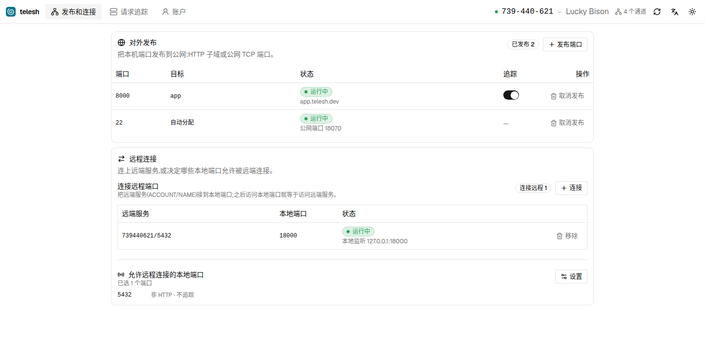
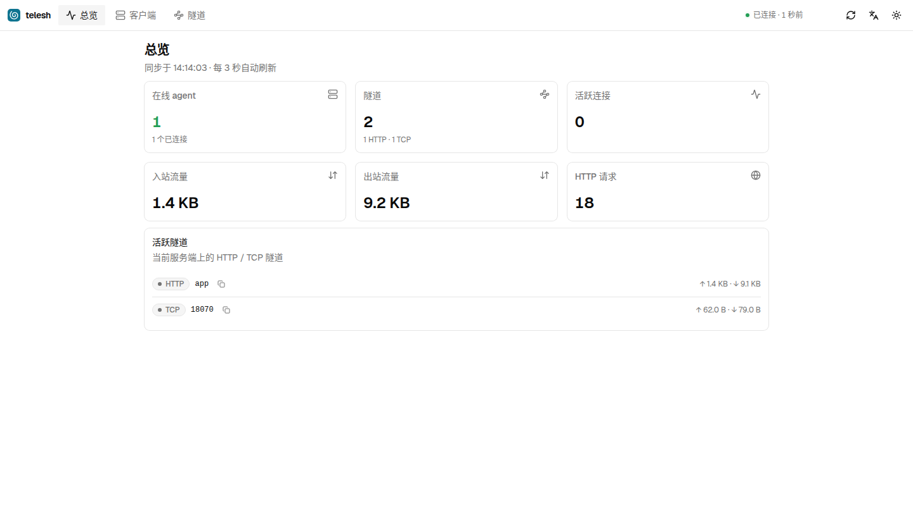

# telesh

[English](README.md) · **简体中文**

**两个桌面应用，一套自托管内网穿透：把本地端口发布到公网，把远端端口镜像到本地。**

telesh 是两个打开就能点的应用。**telesh agent** 跑在要发布服务的那台机器上：它列出本机已经在
监听的端口，把选中的端口发布到公网边缘、以 P2P 方式暴露、或把远端服务镜像到本地端口。
**telesh server** 是服务端那一半：控制面、边缘入口、数据面、可选的内嵌中继，以及你盯着看的
dashboard。两个都是常驻托盘的桌面应用，支持 Linux、Windows 和 macOS，各自随包自带面板——不需要
Node 运行时，也没有 web 资源目录要部署。



## 特性

### 1. telesh agent：一个窗口里完成发布与镜像

点 **+ 发布端口**，agent 就把本机正在监听的端口列出来。选一个，决定它该怎么被访问；agent 会持续
把运行状态收敛到窗口里显示的样子，所以开关立刻生效，重启后也还在。

| 能力 | 在 telesh agent 里 |
| --- | --- |
| 本机端口发现 | 列出正在监听的 TCP 端口与对应进程，通过 `/proc` 反查；在容器里看到的正好是容器内的端口 |
| HTTP 发布 | 固定子域名按 `Host` 路由到本地端口，支持按端口开启请求追踪与一键重放 |
| TCP 发布 | 从服务端的端口段分配公网端口（也可指定）给 SSH、数据库、游戏服等任意 TCP 服务 |
| P2P 入站 | [iroh](https://www.iroh.computer/) 打洞 QUIC，失败时自动回退到加密中继；多个服务共用一个 endpoint |
| 远程镜像 | 把 `ACCOUNT/NAME` 映射到本地监听端口，跟随目录更新，断线后自动重建数据路径 |
| 发布状态 | 每个条目都显示 `pending`、`live`、`error` 或 `target_gone`（本地端口消失），不会静默失败 |
| 账户视图 | 登录账号、公钥、控制服务器、数据目录、会话有效期与最近一次错误都在一处 |

同一个本地端口可以同时发布为 HTTP、TCP 和 P2P，也可以同时开多条远端镜像——一个 agent 进程管理
全部。

### 2. telesh server：服务端那一半，自带 dashboard

公网流量落在 server 这个应用上。首次启动它会写一份可以从托盘打开的 `server.toml`，拉起随包的
控制服务器，并在窗口里显示它自己的 dashboard。



| 能力 | 在 telesh server 里 |
| --- | --- |
| 一个配置文件 | `control_addr`、`ingress_addr`、`data_addr`、TCP 端口段、公网后缀、数据目录，全部有默认值 |
| 边缘入口 | HTTP 按 `Host` 路由、TCP 按端口路由，都经 agent 的数据连接转发 |
| 数据面 | agent 主动连入的 TCP，用 [yamux](https://github.com/hashicorp/yamux/blob/master/spec.md) 分流；服务端从不主动连 agent |
| 内嵌中继 | 可选的进程内 iroh relay，支持手动 TLS 或 ACME / Let's Encrypt，以及 QUIC 地址发现 |
| Dashboard | 总览（agent、隧道、流量、HTTP 请求）、客户端、隧道，以及可抓取的 `/api/metrics/prometheus` |
| 客户端零配置 | relay URL 与数据面地址在登录时下发；agent 只需要控制面地址 |
| 身份 | Ed25519 挑战-应答，首次登录即建 9 位账号（TOFU），12 小时会话，不透明访问令牌在线校验 |

### 3. 两个应用：控制面与数据面分开

公网边缘从不反向连进你的机器：永远是 agent 连出去，而且载荷不和控制消息共用连接。这条分界让
控制协议可以独立演进而不碰转发路径，也是 agent 待在 NAT 后面、没有公网 IP 也能工作的原因。

| 平面 | 传输 | 承载内容 |
| --- | --- | --- |
| 控制面 | WebSocket + JSON | 登录、子域名与 TCP 端口注册、P2P 目录、保活、计量 |
| 数据面 | agent 主动连入的 TCP + yamux | stream 1 是信令（CBOR）；每条公网连接一条纯字节流 |
| P2P | iroh QUIC | 打洞后的点对点载荷；服务端只提供目录与令牌校验 |

```text
公网访问者 ──► telesh server 边缘 ──数据面（yamux）──► telesh agent ──► 127.0.0.1:8000
                         ▲
                         │ 控制面（WebSocket / JSON）：登录、路由、目录、保活
                         │
对端 ──iroh QUIC（打洞直连，失败回退中继）──► telesh agent ──► 127.0.0.1:5432
```

HTTP / TCP 载荷只有一条通路：agent 主动连上来的数据连接。agent 没连上来时，边缘直接回 `503`
（裸 TCP 则关闭），不做无界缓冲。P2P 载荷不经过服务端；服务端只参与目录查询和短期访问令牌校验。

## 下载

安装包发布在 [GitHub Releases](https://github.com/zeaphoo/telesh/releases)。两个应用都自带内嵌
dashboard 的 headless 二进制，不需要额外安装别的东西。

| 应用 | Linux | Windows | macOS |
| --- | --- | --- | --- |
| **telesh agent** | `telesh-agent-app_<版本>_linux_<arch>.deb`（Debian/Ubuntu）、`....AppImage` | `telesh-agent-app_<版本>_windows_x64-setup.exe`（NSIS）、`....msi`、`..._portable.zip` | `telesh-agent-app_<版本>_macos_<arch>.dmg`（Intel `x86_64` / Apple Silicon `arm64`） |
| **telesh server** | `telesh-server-app_<版本>_linux_<arch>.deb`、`....AppImage` | `telesh-server-app_<版本>_windows_x64-setup.exe`、`....msi`、`..._portable.zip` | `telesh-server-app_<版本>_macos_<arch>.dmg` |

同一个 Release 里还有 headless 服务包（带 systemd 单元的 `deb` / `rpm`）与独立压缩包，给没有桌面
环境的服务器用；内容见 [`packaging/README.md`](packaging/README.md)。

系统要求：

- **Linux**：x86_64 或 arm64，需要 WebKitGTK 4.1（Ubuntu 22.04+、Debian 12+ 等提供；deb 会自动
  拉取依赖）。
- **Windows**：Windows 10 / 11（x64），需要 WebView2 运行时（通常随 Edge 已安装）。
- **macOS**：macOS 11+，Intel 或 Apple Silicon，使用系统自带的 WebKit。
- **服务端主机**：需要一个 agent 能连上的公网地址，并在防火墙 / 安全组放行要发布出去的端口。

## 安装

### Linux

deb（推荐，自动处理依赖和桌面集成）：

```bash
sudo apt install ./telesh-agent-app_<版本>_linux_amd64.deb
sudo apt install ./telesh-server-app_<版本>_linux_amd64.deb
```

AppImage（免安装）：

```bash
chmod +x telesh-agent-app_<版本>_linux_amd64.AppImage
./telesh-agent-app_<版本>_linux_amd64.AppImage
```

安装后从应用菜单启动 **telesh agent** 或 **telesh server**。

### Windows

- **安装版**：运行 `..._windows_x64-setup.exe`，按向导完成安装。企业分发 / 静默安装可以用
  `.msi`。
- **便携版**：解压 `..._portable.zip`，保持主程序与 `telesh-sidecar.exe` /
  `telesh-server-sidecar.exe` 在同一目录，直接运行应用。
- 安装包目前未做代码签名，SmartScreen 可能提示「未知发布者」：点「更多信息」→「仍要运行」。

### macOS

打开 `.dmg`，把 **telesh agent** 或 **telesh server** 拖进「应用程序」。配置了发布签名 secrets
时官方包会签名并公证；未签名时首次启动需到「系统设置 → 隐私与安全性」里放行。

### 从源码构建

前置：Rust 1.91+、Node 22、pnpm 10、`cargo install tauri-cli --locked`，以及对应平台的 Tauri 2
系统依赖。打包脚本会构建两个前端、准备各自的 sidecar 并打包：

```bash
git clone https://github.com/zeaphoo/telesh
cd telesh
./scripts/package-linux-app.sh      # deb + AppImage → dist/linux-app/
./scripts/package-windows.sh        # NSIS / MSI / 便携包 → dist/windows/
./scripts/package-mac.sh            # dmg → dist/mac/
```

## 首次启动

### telesh server

- 首次启动会在应用数据目录里写一份 `server.toml`，拉起随包的控制服务器；窗口加载
  `http://127.0.0.1:9009` 上的 dashboard。
- 托盘菜单里的 **打开配置文件** 用来设置 `public_host`（HTTP 隧道挂的域名）以及入口 / 数据面
  端口。配置在启动时读入，改完需要重启应用。
- 默认监听 `0.0.0.0:9009`（控制面 + dashboard）、`0.0.0.0:8080`（公网边缘）与
  `0.0.0.0:9008`（数据面）。对外部署时把边缘、数据面和 TCP 端口段都放到公网上。
- 如果已经有一个 `telesh-server` 在跑（例如 systemd 服务），应用会直接接上它，不再起第二个，
  也不接管它的生命周期。

### telesh agent

- 首次启动会在应用数据目录里生成 `config.toml`，内容是
  `control_server = "127.0.0.1:9009"`。把它改成你服务端的地址（例如
  `control_server = "tunnel.example.com:9009"`），再重启应用。
- 窗口加载 `http://127.0.0.1:16345` 上的 agent 面板（只监听回环）。首次登录时 agent 用
  Ed25519 密钥完成挑战-应答，拿到 9 位账号，并把会话缓存下来。
- 如果已经有一个 `telesh` 在跑，应用会直接接上它，不会起第二个 agent。

### 托盘与窗口

- 关闭窗口默认收进托盘；托盘菜单可以重新打开面板、切换 **关闭窗口时最小化到托盘**，以及退出。
- 托盘就是窗口之外的完整入口：**打开面板**，server 应用还多一项 **打开配置文件**。
- 退出应用会关掉它自己拉起的 sidecar，不会留下一个还在发布端口的孤儿进程。已经在跑的服务
  （systemd 等）不会被碰。

### 数据放在哪

两个应用都把数据放在平台的应用数据目录里：

| 平台 | telesh agent | telesh server |
| --- | --- | --- |
| Linux | `~/.local/share/net.quadhub.telesh/` | `~/.local/share/net.quadhub.telesh-server/` |
| macOS | `~/Library/Application Support/net.quadhub.telesh/` | `~/Library/Application Support/net.quadhub.telesh-server/` |
| Windows | `%APPDATA%\net.quadhub.telesh\` | `%APPDATA%\net.quadhub.telesh-server\` |

- Agent：`config.toml`、Ed25519 身份与缓存的会话（`state`）、发布列表（`publish.json`）、P2P
  入站规则（`p2p.json`）、追踪设置（`settings.json`）、请求追踪记录，以及托盘的 `prefs.json`。
- Server：`server.toml`、`server.sqlite`（账号、密钥、会话、服务、令牌哈希）、ACME 缓存，以及
  托盘的 `prefs.json`。
- 卸载应用不会删除这些目录；需要彻底清理时手动删除。

## 在应用里怎么用

### telesh agent

| 操作 | 位置 |
| --- | --- |
| 发布端口 | **+ 发布端口**：选端口，再选 HTTP（子域名）、TCP（指定或自动分配公网端口）或 P2P |
| 镜像远端服务 | 「远程连接」里的 **+ 连接**：填 `ACCOUNT/NAME` 和要监听的本地端口 |
| 允许 P2P 入站 | 「允许远程连接的本地端口」→ 设置：全部端口、选定端口，或全部关闭 |
| 追踪请求 | 每个端口的 **追踪** 开关；「请求追踪」页显示方法、路径、状态、耗时、请求头与响应体，并可重放 |
| 查看身份 | **账户**：账号、显示名、公钥、控制服务器、数据目录、会话有效期与最近一次错误 |

### telesh server

| 操作 | 位置 |
| --- | --- |
| 看流量 | **总览**：在线 agent、隧道数、活跃连接、入站/出站流量、HTTP 请求数 |
| 看谁连着 | **客户端**：每个在线 agent 的子域名、账号与在线时长 |
| 看暴露了什么 | **隧道**：HTTP 子域名与 TCP 端口，含状态和字节计数 |
| 抓指标 | 控制端口上的 `GET /api/metrics/prometheus` |
| 改服务端配置 | 托盘 → **打开配置文件**，改完重启应用 |

## 安全

- 控制面目前是 `ws://`。挑战-应答保护了登录身份，但链路本身没有加密：公网部署请在控制端口
  前面终止 TLS（`wss://` 尚未内置）。P2P 的 QUIC 连接是加密的，并由 `EndpointId` 认证。
- 服务端 dashboard 跑在 `control_addr` 上，没有认证。它只读，但会暴露 agent、隧道与流量信息；
  公网部署时请把控制端口放在内网，或在前面加一层带认证的反向代理。
- 访问 P2P 服务使用短期、不透明的访问令牌，作用域限定在 `account/name`。agent 向服务端在线
  校验，服务端只存令牌的 SHA-256：没有签名密钥，也没有离线校验。
- 本机 agent 面板只 bind `127.0.0.1:16345`。任何能访问它的本机用户都能发布端口，不要把它
  暴露到网络上。
- agent 没连上就不转发：边缘回 `503`，而不是先缓冲一堆请求。

## 更多文档

| 文档 | 内容 |
| --- | --- |
| [`docs/design-control.md`](docs/design-control.md) | 控制面传输、JSON 编码、握手与完整消息表 |
| [`docs/design-dataplane.md`](docs/design-dataplane.md) | agent 主动连入的数据面、yamux 分流、信令、限额与重连规则 |
| [`docs/design-p2p.md`](docs/design-p2p.md) | iroh P2P、镜像、流前导、访问令牌与端口映射 |
| [`docs/design-identity.md`](docs/design-identity.md) | 账号、密钥、会话、令牌、命名空间与 SQLite schema |
| [`docs/cli.md`](docs/cli.md) | headless CLI 与服务端运维参考（脚本化 / 纯服务器场景） |
| [`packaging/README.md`](packaging/README.md) | 安装包内容、Release 资产、构建脚本与桌面打包 |
| [`CHANGELOG.md`](CHANGELOG.md) | 版本变更 |

## 许可

telesh 以 **Apache License 2.0** 发布，全文见 [`LICENSE`](LICENSE)。
